# 📑 Sudarshana (StegShield) — Rigorous Research Protocol & TIFS Target Blueprint

**Target Venues:** IEEE Transactions on Information Forensics and Security (TIFS) · ACM CCS · IEEE TDSC · Forensic Science International  
**Core Narrative Pivot:** *From "Architecture Novelty" to "Generalization, Uncertainty Quantification, and Operational Efficiency"*  
**Date:** November 2026

---

## 1. Executive Summary & Narrative Realignment

### 1.1 Why Pivot the Narrative?
In top-tier security and forensic venues (IEEE TIFS, ACM CCS, IEEE S&P), proposing "multi-branch CNNs" or "transformer attention" as standalone novelties frequently triggers reviewer pushback because multi-stream networks and attention are established paradigms. 

Instead, **Sudarshana (StegShield)** is reframed around solving the fundamental crisis in applied steganalysis:
> *"Existing deep learning steganalyzers overfit to homogeneous training splits (e.g., standard BOSSbase) and collapse under Cover-Source Mismatch (CSM), JPEG recompression, and unseen zero-day embedding algorithms. Furthermore, they function as black boxes without calibrated uncertainty or edge viability."*

### 1.2 The Three Research Pillars
1. **Cross-Domain Generalization & Robustness**: Resisting cover-source mismatch across disjoint camera pipelines and quality factor (QF) variations.
2. **Calibrated Uncertainty & Open-Set Rejection**: Energy-based out-of-distribution (OOD) scoring to detect unseen stego algorithms without elevating False Positive Rates (FPR) on benign covers.
3. **Faithful Forensic Interpretability & Edge Efficiency**: Quantitative evaluation of explanation faithfulness (deletion/insertion impact, ground-truth IoU) coupled with sub-100ms INT8 CPU edge execution.

---

## 2. Research Questions (RQs) & Hypotheses

| RQ | Research Question | Formal Hypothesis ($H$) | Verification Method |
|:---|:---|:---|:---|
| **RQ1** | Can fusing spatial residuals and DCT frequency representations significantly outperform single-domain models under Cover-Source Mismatch (CSM) and JPEG-QF shifts? | **$H_1$**: Multi-domain fusion maintains significantly higher detection AUC ($p < 0.01$) under cross-camera and cross-QF shifts than spatial-only (SRNet/Xu-Net) or frequency-only baselines. | Disjoint camera hold-out tests (BOSSbase, ALASKA2, YFCC subsets) + QF $\in \{75, 85, 95\}$. |
| **RQ2** | Does learned Cross-Attention fusion provide statistically significant improvements over naive concatenation, gated summation, or feature addition? | **$H_2$**: Query-Key-Value inter-domain cross-attention achieves a statistically superior Pareto trade-off between sensitivity and parameter overhead compared to linear concatenation or static gating. | Controlled fusion ablation on identical frozen backbones; paired Wilcoxon signed-rank test. |
| **RQ3** | Can Helmholtz energy-based scoring reliably isolate images embedded with novel algorithms or payloads without prior exposure? | **$H_3$**: Free-energy logit scoring yields lower False Positive Rates ($\text{FPR} \le 5\%$) at $95\%$ True Positive Rate ($\text{TPR}$) on novel zero-day stego compared to maximum softmax probability and ODIN baselines. | Open-Set evaluation matrix with held-out algorithms (MiPOD, HILL, J-UNIWARD) and payloads ($0.2\text{--}0.5$ bpp). |
| **RQ4** | Do Grad-CAM saliency heatmaps faithfully reflect ground-truth steganographic bit-modification distributions? | **$H_4$**: High-attribution pixel regions identified by Grad-CAM correlate with actual modified embedding locations, and sequential pixel deletion produces steeper confidence drops than random masking. | Ground-truth embedding mask IoU + Deletion/Insertion faithfulness curves across $\ge 3$ random seeds. |
| **RQ5** | Can post-training INT8 quantization and structured filter pruning achieve real-time CPU latency ($<80\text{ms}$) with $\le 5\%$ drop in detection accuracy? | **$H_5$**: Quantized integer-only inference reduces model memory by $\ge 3.5\times$ and latency by $\ge 2\times$ on commodity CPUs and ARM boards (Raspberry Pi/Jetson) with minimal accuracy degradation. | Latency, memory, and accuracy profiling across FP32, Pruned (10–30%), and INT8 quantized variants. |

---

## 3. Experimental Protocols & Protocols Matrix

### 3.1 Datasets & Strict Disjoint Splitting
- **BOSSbase v1.01**: 10,000 grayscale PGM images ($512 \times 512$).
- **ALASKA2**: 75,000 JPEG images across diverse real-world sensors.
- **YFCC100M Subset / BOWS2**: For external Cover-Source Mismatch (CSM) evaluation.
- **Splitting Rule (Zero-Bleed)**:
  - Disjoint camera partitioning: All images from specific camera models (or photographer IDs) are strictly reserved for the test split.
  - Pair-Safe constraint: Clean cover $X$ and its stego counterpart $X_{\text{stego}}$ are strictly bound to the identical split.
  - Multi-Seed Requirement: All experiments executed across $N \ge 3$ random seeds ($\text{seed} \in \{42, 1337, 2026\}$) to report **$\text{mean} \pm \text{std}$**.

---

## 4. Key Experimental Matrices

### 4.1 Cross-Domain & Cover-Source Generalization Matrix (RQ1)
| Setting | Training Set | Evaluation Set | Tested Effect | Primary Metric |
|:---|:---|:---|:---|:---|
| **In-Domain (Control)** | BOSSbase (Cameras A, B) | BOSSbase (Cameras A, B) | Baseline closed-set accuracy | Acc, AUC, F1 |
| **Source Mismatch (CSM)** | BOSSbase (Cameras A, B) | BOSSbase (Camera C - Held Out) | Sensor pipeline shift | $\Delta \text{Acc}$, AUC |
| **Cross-Dataset** | BOSSbase (Clean) | BOWS2 / YFCC Subset | External sensor distribution | AUC, EER |
| **Spatial $\rightarrow$ JPEG** | Spatial covers (LSB / WOW) | JPEG compressed covers (QF=85) | Representation domain shift | Acc, Recall |
| **Mixed-QF Shift** | Trained on QF $\in \{90, 95\}$ | Evaluated on QF $= 75$ | Aggressive recompression | AUC, ROC |

### 4.2 Fusion Mechanism & Branch Ablation Matrix (RQ2)
| ID | Architecture Variant | Fusion Mechanism | Active Branches | Expected Insight |
|:---|:---|:---|:---|:---|
| **V1** | Spatial Baseline | None | Branch A (Pixel SRM) | Spatial-only ceiling |
| **V2** | Frequency Baseline | None | Branch B (DCT CNN) | Frequency-only ceiling |
| **V3** | Statistical Baseline | None | Branch C (Stats MLP) | Mathematical feature sensitivity |
| **V4** | Generative Baseline | None | Branch D (EfficientNet) | Latent synthetic artifact sensitivity |
| **V5** | Dual-Branch Concat | Simple Concatenation | Branch A + B | Baseline multi-domain benchmark |
| **V6** | Tri-Branch Concat | Simple Concatenation | Branch A + B + C | Traditional dense fusion |
| **V7** | Quad-Branch Concat | Simple Concatenation | Branch A + B + C + D | Full dense baseline |
| **V8** | Gated Sum Fusion | Learned Scalar Gating | Branch A + B + C + D | Dynamic linear weighting |
| **V9** | **Cross-Attention (Ours)** | **Transformer (Q=A, K/V=B)** | **Branch A + B + C + D** | **Hypothesized Optimal ($H_2$)** |

### 4.3 Open-Set Out-of-Distribution (OOD) Matrix (RQ3)
| Condition | Dataset / Algorithm | Payload Rate | System Output Target | Success Metric |
|:---|:---|:---|:---|:---|
| **Known In-Distribution** | WOW, S-UNIWARD, J-UNIWARD | $0.4$ bpp | Classified: CLEAN / STEGO | In-Domain Accuracy $\ge 90\%$ |
| **Unseen Algorithm (OOD)** | MiPOD / HILL / Generative Stego | $0.4$ bpp | Classified: `UNKNOWN` | True Unknown Rate (TUR) $\ge 80\%$ |
| **Unseen Payload (OOD)** | Known algorithms at $0.1$ or $0.7$ bpp | $0.1$ & $0.7$ bpp | Calibrated Detection / Flag | FPR $\le 5\%$ at TPR $= 95\%$ |
| **Unseen Clean Source** | Unseen Camera RAW / Clean Covers | N/A (Clean) | Classified: `CLEAN` | Clean FPR $\le 3\%$ |
| **Benign Transformations** | Clean covers with Gaussian blur / contrast | N/A | Classified: `CLEAN` | False Alarm Rate (FAR) |

### 4.4 Explanation Faithfulness & Interpretability Matrix (RQ4)
| Metric | Formulation / Protocol | Interpretation |
|:---|:---|:---|
| **Ground-Truth IoU** | $\text{IoU} = \frac{\text{CAM}_{\text{threshold}} \cap \text{Mask}_{\text{modified}}}{\text{CAM}_{\text{threshold}} \cup \text{Mask}_{\text{modified}}}$ | Measures whether Grad-CAM highlights actual manipulated pixels. |
| **Deletion Impact (Faithfulness)** | Mask top $k\%$ ($k \in \{5, 10, 20, 50\}$) highest Grad-CAM pixels and measure confidence drop $\Delta P(\text{Stego})$. | Steeper confidence degradation indicates the network relied genuinely on those pixels. |
| **Insertion Impact** | Start from blank canvas; iteratively insert top $k\%$ attribution pixels and track confidence rise. | Fast confidence recovery validates sufficiency of identified features. |
| **Multi-Seed Stability** | $\text{IoU}(\text{CAM}_{\text{seed}_1}, \text{CAM}_{\text{seed}_2})$ on identical test instances across 3 distinct training runs. | Verifies explanation determinism and avoids stochastic artifact hallucination. |

### 4.5 Edge Deployment & Resource Efficiency (RQ5)
| Variant | Precision | Parameter Count | Model Footprint | CPU Latency (x86) | ARM Latency (R-Pi 4 / Jetson) | Accuracy Drop |
|:---|:---|:---|:---|:---|:---|:---|
| **Full Precision** | FP32 | ~19.9 M | ~80 MB | ~180 ms | ~650 ms | Baseline ($0.0\%$) |
| **Structured Pruned (20%)** | FP32 | ~15.9 M | ~64 MB | ~145 ms | ~510 ms | $\le 0.8\%$ |
| **Post-Training INT8 (PTQ)** | INT8 | ~19.9 M | ~20 MB | ~58 ms | ~195 ms | $\le 2.5\%$ |
| **Pruned + Quantized (Ours)** | INT8 | ~15.9 M | **~16 MB** | **<50 ms** | **<160 ms** | **$\le 3.0\%$** |

---

## 5. Statistical Rigor & Hypothesis Testing Suite

To satisfy IEEE TIFS / ACM CCS review guidelines:
1. **Paired Statistical Significance**:
   - Compare proposed cross-attention vs. ablated baselines using the **Wilcoxon signed-rank test** (non-parametric) and **paired two-tailed Student's t-test**.
   - Significance threshold: $\alpha = 0.05$; highly significant: $p < 0.01$.
2. **Classifier Output Disagreement**:
   - Apply **McNemar's test** on paired $2 \times 2$ contingency tables for identical test sets to prove performance gains are not chance artifacts.
3. **Multiple Testing Correction**:
   - Implement **Bonferroni / Holm-Bonferroni correction** when evaluating across multiple quality factors or dataset subsets.

---

## 6. Project Timeline & Milestone Execution

```mermaid
flowchart LR
    A["M1: Dataset Splits & Baseline Setup"] --> B["M2: CSM & QF Shift Experiments"]
    B --> C["M3: Fusion & Branch Ablation Suite"]
    C --> D["M4: Open-Set Energy OOD Evaluation"]
    D --> E["M5: Grad-CAM Faithfulness Testing"]
    E --> F["M6: INT8 & Pruning Edge Benchmarks"]
    F --> G["M7: Statistical Analysis & Paper Writing"]
    G --> H["M8: Journal Submission (IEEE TIFS)"]
```

---
*Document permanently registered in workspace as official TIFS research blueprint.*
